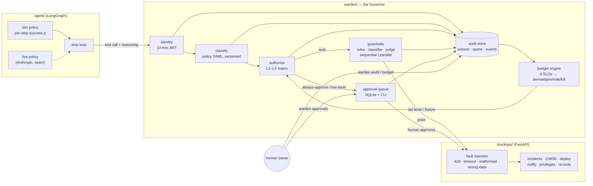

# Architecture

Every agent tool call passes through the warden gateway — the agent never
talks to the ops estate directly. The gateway is a pipeline of decisions,
each of which is recorded well enough to answer the auditor's question:
*under what governance regime was this action authorized?*

## The request lifecycle

1. **identity.validate** — the session JWT (10-minute TTL, scoped to the
   manifest) is checked; expired or over-scope calls are denied and audited.
2. **policy.classify** — the three-tier trust model: first-match-wins YAML
   rules classify the action by blast radius (read_only / reversible_write /
   always_approve + risk), conditioned on parameters (a tier-1 deploy ≠ a
   sandbox deploy). The policy version is stamped into the decision.
3. **authz.decide** — the decision matrix maps (current L1–L5 level × trust
   tier) to `auto` or `approval_required`. The five always-approve categories
   (production deploys, external comms, financial transactions, data
   deletion, privilege changes) gate at L4 and below, always.
4. **guardrails** — on the auto path, three checks (regex rules, keyword
   classifier, heuristic/LLM judge) run sequentially or in parallel; a trip
   blocks the call.
5. **tool.execute** — the call is forwarded to mockops, through its fault
   injection layer.
6. **budget tick** — the engine recomputes the six SLOs over the rolling
   window and may demote, promote, or freeze the agent before its next call.

Every stage emits a span; action + spans + guardrail verdicts + budget
events land in SQLite. `warden audit <action_id>` reconstructs the story.

## Components

| Path | Responsibility |
|---|---|
| `src/agent_governor/mockops/` | Deterministic mock ITSM estate + seeded fault injection |
| `src/agent_governor/agent/` | LangGraph remediation agent; sim policy with dial-a-mistake-rate |
| `src/agent_governor/warden/` | Identity, policy, authz, guardrails, approvals, audit, budget, CLI |
| `policies/` | classification.yaml · guardrails.yaml · budget/{demo,realistic}.yaml |
| `benchmarks/` | Experiments 1–3 + chart kit + self-contained HTML report |
| `examples/` | Per-milestone runnable stories + `demo.py` (the 3-minute arc) |
